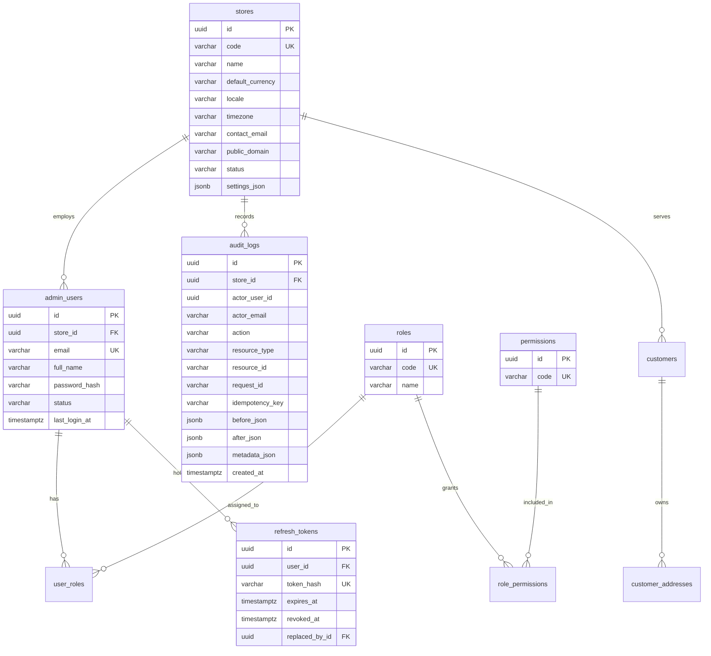
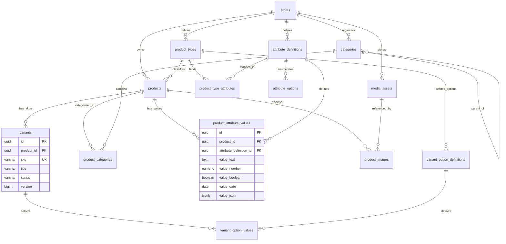
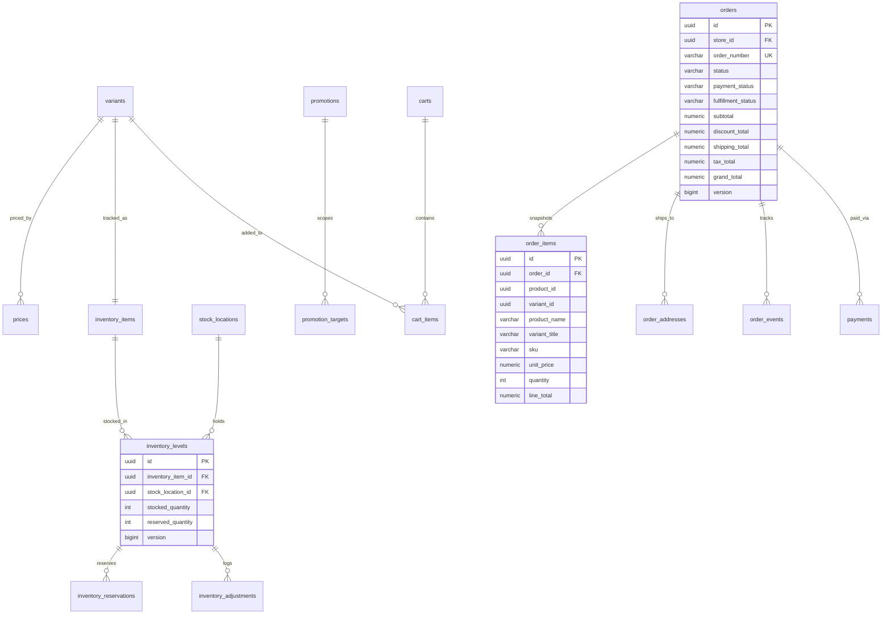
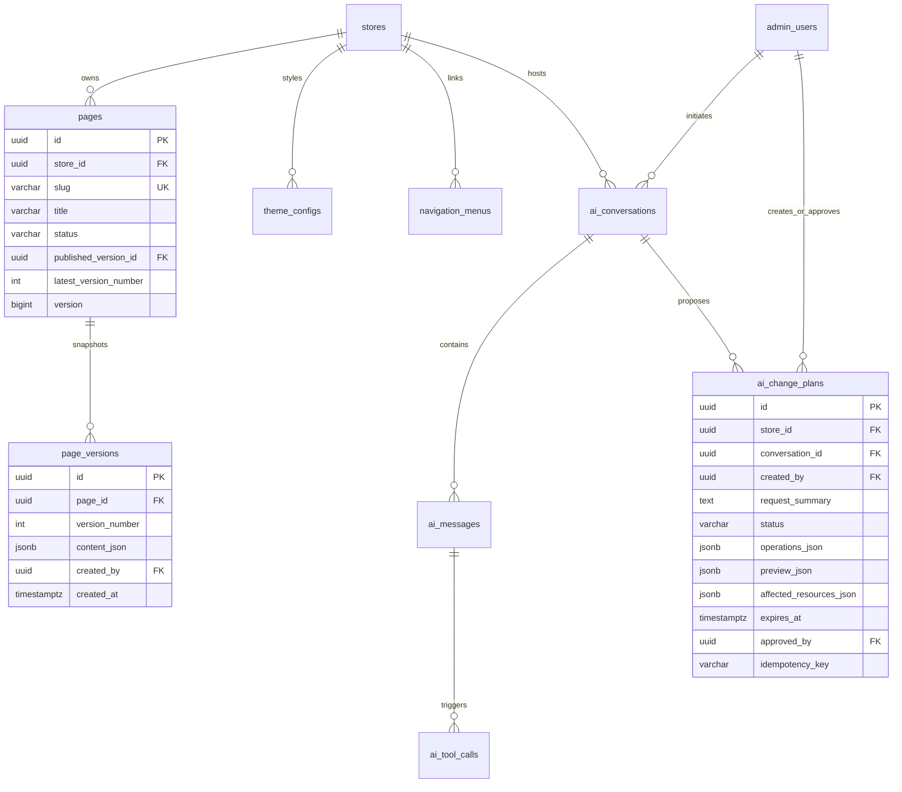

# Entity-Relationship Diagram (ERD) & Domain Model — Dat Commerce

## 1. Core Domain Distinctions

To prevent schema ambiguity across catalog, storefront, and AI tooling:

1. **Product** (`products`): Commercial/editorial entity (e.g., *Ridge Runner GTX*, *FormaBook Pro 14*). Holds general metadata: `name`, `slug`, `brand`, `description`, `status`, SEO fields, and belongs to **one primary `product_type_id`**.
2. **Product Type** (`product_types`): Schema template defining which **dynamic attributes** (`product_type_attributes`) and **variant option dimensions** (`variant_option_definitions`) a product of that type requires or supports (e.g., `Shoes`, `Laptop`, `Phone`).
3. **Variant** (`variants`): A purchasable SKU unit under a Product (e.g., *Ridge Runner GTX — Olive / US 10*, SKU `RR-GTX-OLV-10`). Each Variant carries its own `sku`, option values (`size`, `color`, `ram_config`), `prices`, and `inventory_items`/`inventory_levels`.
4. **Category** (`categories` + `product_categories`): Storefront navigation & taxonomy tree (supports `parent_id`, many-to-many with `products`, and optional `default_product_type_id`). A product can belong to multiple categories (e.g., *Footwear* and *Trail Running*).

### Complete Dynamic Attribute Examples

#### Example A: Product Type `Shoes`
- **Product Attributes** (stored in `product_attribute_values` with typed columns):
  - `material` (`TEXT`, required, filterable, searchable) — e.g., `"Ripstop Mesh & Gore-Tex"`
  - `gender` (`ENUM`, required, filterable: `["Men", "Women", "Unisex"]`) — e.g., `"Unisex"`
  - `waterproof` (`BOOLEAN`, required, filterable) — e.g., `true`
  - `sole_height` (`NUMBER`, optional, unit `"mm"`, min `10`, max `60`) — e.g., `32`
- **Variant Option Definitions** (`variant_option_definitions` → `variant_option_values`):
  - `size`: `"8"`, `"9"`, `"10"`, `"11"`
  - `color`: `"Olive"`, `"Crimson"`, `"Chalk"`

#### Example B: Product Type `Laptop`
- **Product Attributes**:
  - `cpu` (`TEXT`, required, filterable, searchable) — e.g., `"Intel Core i5-1335U"`
  - `ram_gb` (`NUMBER`, required, filterable, unit `"GB"`, min `4`, max `256`) — e.g., `16`
  - `storage_gb` (`NUMBER`, required, filterable, unit `"GB"`, min `128`, max `8192`) — e.g., `512`
  - `screen_inches` (`NUMBER`, required, filterable, unit `"inch"`, min `11`, max `18`) — e.g., `15.6`
- **Variant Option Definitions**:
  - `ram_config`: `"16GB"`, `"32GB"`
  - `storage_config`: `"512GB"`, `"1TB"`

---

## 2. Identity, Store & Audit Domain

---

## 3. Catalog & Dynamic Attributes Domain

---

## 4. Pricing, Inventory, Promotion, Cart & Order Domain

---

## 5. CMS, Theme & AI Operations Domain

