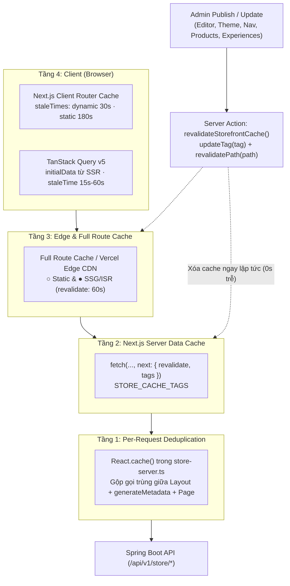

# Chiến lược Rendering & Caching (SSR, SSG, ISR, CSR) — Dat Commerce Web

> Tài liệu kiến trúc chuẩn cho `apps/web` (Next.js 16.4.6 App Router + React 19 + TanStack Query v5) kết nối backend `services/api` (Spring Boot 3).

---

## 1. Mục tiêu thiết kế

Hệ thống storefront thương mại điện tử cần đồng thời đạt 4 yêu cầu thường xung đột nhau:

1. **Chuyển trang tức thì (< 50–150ms)**: Người dùng bấm qua lại giữa Home, Shop, Categories, Product Detail trên header/storefront không bị khựng hay nháy skeleton liên tục.
2. **Tối ưu SEO tuyệt đối**: Trang chủ, danh mục, bộ sưu tập, sản phẩm và trang CMS phải trả về đầy đủ HTML, `generateMetadata` động, `canonical`, OpenGraph/Twitter và JSON-LD ngay từ response đầu tiên.
3. **Cập nhật tức thì sau khi Merchant Publish (0s trễ)**: Khi Admin sửa Theme, Header/Footer, Navigation, Page CMS, Seasonal Experience, Product hoặc Category, storefront phải hiển thị bản mới ngay lập tức mà không phải đợi hết chu kỳ cache.
4. **An toàn cho các trang cá nhân hóa / giao dịch**: Giỏ hàng, thanh toán, lịch sử đơn hàng, Admin và Login tuyệt đối không được cache chung giữa các người dùng hoặc bị index bởi công cụ tìm kiếm.

---

## 2. Tổng quan các chế độ Render trong Next.js App Router

| Ký hiệu `next build` | Chế độ | Thời điểm render | Cache CDN / Full Route | Prefetch `<Link>` | Khi nào sử dụng |
|---|---|---|---|---|---|
| **`○` (Static / ISR)** | Static + Incremental Static Regeneration | Build time + chạy ngầm mỗi `revalidate` giây (hoặc on-demand) | **Có** | **Full route payload** | Các route URL cố định, nội dung dùng chung cho mọi khách (Home, Shop mặc định, About, Categories, Collections, Contact). |
| **`●` (SSG / ISR)** | Dynamic Segment có `generateStaticParams()` + `revalidate` | Build time cho các slug phổ biến + On-demand ISR cho slug mới (`dynamicParams = true`) | **Có** | **Full route payload** | Chi tiết sản phẩm (`/store/product/[slug]`), chi tiết danh mục (`/store/category/[slug]`), chi tiết bộ sưu tập (`/store/collection/[slug]`). |
| **`ƒ` (Dynamic SSR)** | Server-Rendered on Demand | Mỗi request (hoặc dùng lại Client Router Cache trong `staleTimes.dynamic`) | **Không** | Chỉ prefetch tới `loading.tsx` | Route phụ thuộc request/slug không cố định hoặc query tìm kiếm (`/store/search`, `/store/[slug]`, `/store/confirmation/[orderNumber]`, `/sitemap.xml`, `/admin`). |
| **CSR (Client Shell)** | Client-Side Hydration + TanStack Query | Trên trình duyệt | — | — | Dữ liệu riêng từng user (Cart, Wishlist, Account, History), bộ lọc tương tác trên Listing, Admin workspace, Visual Theme Editor. |

---

## 3. Ma trận Route thực tế trong `apps/web/app/`

### Storefront (`app/(storefront)/`)

| Route | File App Router | Chế độ `next build` | `revalidate` | SEO (`robots`) | Ghi chú kiến trúc |
|---|---|---|---:|---|---|
| `/` | `app/(storefront)/page.tsx` | `○` ISR | `60s` (`layout` 30s) | `index, follow` | SSR 16 sản phẩm mới/bán chạy + CMS `home` + `Organization` & `WebSite` JSON-LD. |
| `/store` | `app/(storefront)/store/page.tsx` | `○` Static | `60s` | `308 -> /` | Redirect vĩnh viễn về `/` để tránh trùng lặp URL trang chủ. |
| `/store/shop` | `app/(storefront)/store/shop/page.tsx` | `○` ISR | `60s` | `index, follow` | Server chỉ SSR trang mặc định; `<Listing />` trong `<Suspense>` đọc `useSearchParams()` ở client để tránh bị ép sang `ƒ`. |
| `/store/product/[slug]` | `app/(storefront)/store/product/[slug]/page.tsx` | `●` SSG/ISR | `60s` | `index, follow` | `generateStaticParams` prerender top 100 slug; chỉ lấy `size: 5` rồi lọc đúng 4 sản phẩm liên quan; có `loading.tsx` riêng dạng 2 cột. |
| `/store/category/[slug]` | `app/(storefront)/store/category/[slug]/page.tsx` | `●` SSG/ISR | `60s` | `index, follow` | `generateStaticParams` theo danh sách category; `<Listing />` xử lý filter/sort/page qua URL trên client. |
| `/store/collection/[slug]` | `app/(storefront)/store/collection/[slug]/page.tsx` | `●` SSG/ISR | `60s` | `index, follow` | `generateStaticParams` theo danh sách collection; có `BreadcrumbList` + `CollectionPage` JSON-LD. |
| `/store/categories` | `app/(storefront)/store/categories/page.tsx` | `○` ISR | `60s` | `index, follow` | `CollectionPage` + `ItemList` JSON-LD. |
| `/store/collections` | `app/(storefront)/store/collections/page.tsx` | `○` ISR | `60s` | `index, follow` | Kết hợp CMS `collections` + danh sách bộ sưu tập. |
| `/store/about` | `app/(storefront)/store/about/page.tsx` | `○` ISR | `60s` | `index, follow` | Render `CmsPageView` + `BreadcrumbList` JSON-LD. |
| `/store/contact` | `app/(storefront)/store/contact/page.tsx` | `○` ISR | `60s` | `index, follow` | Form liên hệ client + `BreadcrumbList` JSON-LD. |
| `/store/[slug]` | `app/(storefront)/store/[slug]/page.tsx` | `ƒ` Dynamic | `60s` Data Cache | `index, follow` | Custom CMS pages tạo bởi Admin; `notFound()` nếu chưa publish. |
| `/store/search` | `app/(storefront)/store/search/page.tsx` | `ƒ` Dynamic | `60s` Data Cache | `noindex, follow` | Đọc `searchParams.q` để tạo title động; chặn index kết quả tìm kiếm nội bộ. |
| `/store/cart`, `/checkout`, `/confirmation`, `/wishlist`, `/account`, `/history` | `app/(storefront)/store/<name>/page.tsx` | `○` Shell + CSR | — | `noindex, nofollow` | Shell HTML tĩnh, dữ liệu giỏ hàng/tài khoản/lịch sử tải theo session riêng trên client. |
| `/store/confirmation/[orderNumber]` | `app/(storefront)/store/confirmation/[orderNumber]/page.tsx` | `ƒ` Dynamic | — | `noindex, nofollow` | Chi tiết biên nhận đơn hàng theo `orderNumber`. |

### Hạ tầng & Quản trị

| Route | Chế độ | Ghi chú |
|---|---|---|
| `/admin/[[...route]]` | `ƒ` Dynamic + CSR | `noindex, nofollow`, tách riêng khỏi `(storefront)` layout để không dính CSS/chrome của khách. |
| `/login` | `○` Static + CSR | `noindex, nofollow`. |
| `/sitemap.xml` | `ƒ` Dynamic | `force-dynamic`, tổng hợp động sản phẩm, danh mục, bộ sưu tập và custom CMS pages (`GET /api/v1/store/pages`). |
| `/robots.txt` | `○` Static | Chặn `/admin`, `/login`, `/api/`, `/store/search` và toàn bộ route giao dịch. |

---

## 4. Kiến trúc 4 tầng Cache & Chống Duplicate Fetch

### Chi tiết từng tầng

1. **Tầng 1 — `React.cache()` trong `apps/web/src/lib/store-server.ts`**:
   - Trong Next.js, khi truyền `signal: AbortSignal.timeout(2500)` vào `fetch()`, cơ chế fetch memoization mặc định trong cùng một request sẽ bị bỏ qua.
   - Vì vậy, mọi hàm `fetchStorePage`, `fetchStoreTheme`, `fetchStoreNavigation`, `fetchStoreActiveExperience`, `fetchStoreProduct`, `fetchStoreProductsByQuery`, `fetchStoreCategories`, `fetchStoreCollections`, `fetchStoreAnimationPresets` đều được bọc trong `React.cache(...)`.
   - Khi render `/`, `StorefrontLayout`, `generateMetadata()` và `HomePage()` cùng gọi `fetchStoreTheme()` và `fetchStorePage("home")`, backend chỉ nhận **đúng 1 request** cho mỗi endpoint.
2. **Tầng 2 — Next.js Data Cache với `STORE_CACHE_TAGS` (`apps/web/src/lib/store-cache-tags.ts`)**:
   - Mọi server fetch gắn tag chuẩn (`store-theme`, `store-nav`, `store-experience`, `store-pages`, `store-page:<slug>`, `store-catalog`, `store-categories`, `store-collections`, `store-presets`).
   - TTL dự phòng: `60s` (riêng `store-experience` là `30s` để khớp thêm với các chiến dịch hẹn giờ).
3. **Tầng 3 — Full Route Cache & Vercel Edge CDN**:
   - `app/(storefront)/layout.tsx` **không** dùng `export const dynamic = "force-dynamic"`.
   - Các trang public cố định dùng `export const revalidate = 60`; các trang `[slug]` trọng yếu dùng `generateStaticParams()` + `revalidate = 60` + `dynamicParams = true`.
4. **Tầng 4 — Client Router Cache & TanStack Query Hydration**:
   - `apps/web/next.config.ts` bật `experimental.staleTimes: { dynamic: 30, static: 180 }` giúp quay lại các route `ƒ (Dynamic)` trong 30s không bị nháy skeleton.
   - `StorefrontShell.tsx`, `CmsPageView.tsx`, `ProductPageView.tsx`, `Listing` nhận `initialData` từ SSR kèm `staleTime` hợp lý (`15s–60s`) thay vì `staleTime: 0` + `initialDataUpdatedAt: 0` (tránh bão refetch ngay sau khi SSR vừa render xong), đồng thời vẫn đồng bộ `queryClient.setQueryData(...)` qua `useEffect` khi props SSR cập nhật và giữ `refetchOnWindowFocus: true`.

---

## 5. Chiến lược On-Demand Revalidation

Để đạt vừa **tốc độ Static/ISR** vừa **live ngay khi Admin bấm Publish**, dự án dùng Next.js Server Action `revalidateStorefrontCache` tại `apps/web/src/lib/revalidate-store.ts`:

- **Tại sao dùng Server Action thay vì Route Handler `/api/revalidate`?**
  - `infra/caddy/Caddyfile` và `apps/web/next.config.ts` đều reverse-proxy toàn bộ `/api/*` sang Spring Boot (`api:8080`). Đặt ở Server Action (`"use server"`) giúp gọi trực tiếp `updateTag()` và `revalidatePath()` của Next.js 16.4.6 mà không xung đột routing và không cần secret header thủ công.

### Bảng ánh xạ Admin Mutation → Cache Invalidation

| Khu vực Admin | File | Hành động | Tags bị xóa (`updateTag`) | Paths được làm mới (`revalidatePath`) |
|---|---|---|---|---|
| **Visual Editor** | `features/editor/editor.tsx` | Publish Page / Rollback Page / Publish Theme | `store-pages`, `store-page:<slug>`, `store-theme` | `/`, `/store/<slug>` |
| **Theme Settings** | `features/admin/theme-settings.tsx` | Save & Publish / Publish Version / Rollback Theme | `store-theme` | `/` (layout) |
| **Header & Nav** | `features/editor/ChromeEditorForms.tsx`, `features/admin/utility.tsx` | Cập nhật Main Navigation | `store-nav` | `/` (layout) |
| **Experiences** | `features/experiences/builder/ExperiencesHub.tsx`, `ExperienceStudio.tsx` | Activate / Deactivate / Schedule / Rollback / Remove / Update Settings | `store-experience` | `/` (layout) |
| **Products** | `features/admin/products.tsx` | Create / Save / Update Variant / Add Variant / Adjust Inventory / Delete | `store-catalog` | `/`, `/store/shop`, `/store/product/<slug>` |
| **Categories** | `features/admin/categories.tsx` | Create / Save / Delete | `store-categories`, `store-catalog` | `/`, `/store/categories`, `/store/shop` |

---

## 6. Xử lý `searchParams`, Prefetch và `loading.tsx`

### Pattern cho trang có bộ lọc URL (`/store/shop`, `/store/category/[slug]`)
- **Không** đọc `await searchParams` trong Server Component của `/store/shop` và `/store/category/[slug]`, vì việc đó ép Next.js biến toàn bộ route thành `ƒ (Dynamic)` và tắt prefetch của `<Link>` trên header.
- Thay vào đó:
  1. Server Component SSR phiên bản mặc định (`page = 0, size = 6, sort = "featured"`).
  2. Client Component `<Listing />` được bọc trong `<Suspense>` và dùng `useSearchParams()` + `areListingStatesEqual(urlState, initialUrlState)` để:
     - Hiển thị **ngay lập tức** dữ liệu SSR khi vào URL mặc định (0 skeleton, 0 client fetch thừa).
     - Tự động fetch đúng kết quả lọc/trang khi người dùng mở hoặc chia sẻ URL có query (`?category=...&sort=low&page=2`).

### Phân tầng `loading.tsx`
- `app/(storefront)/loading.tsx` & `app/(storefront)/store/loading.tsx`: Skeleton chung cho vùng `<main>` khi chuyển vào route dynamic chưa có trong Client Router Cache.
- `app/(storefront)/store/product/[slug]/loading.tsx`: Skeleton 2 cột khớp bố cục `.product-detail` cho các slug sản phẩm mới chưa được prerender.

---

## 7. Anti-patterns cần tránh khi phát triển tính năng mới

1. **Không đặt `export const dynamic = "force-dynamic"` hoặc `cookies()`/`headers()` ở `app/(storefront)/layout.tsx`**: Một dòng này sẽ vô hiệu hóa Static/ISR và prefetch của toàn bộ storefront.
2. **Không dùng `cache: "no-store"` trong `store-server.ts`**: Luôn dùng `next: { revalidate, tags }` + `React.cache()`, kết hợp `revalidateStorefrontCache()` ở phía Admin.
3. **Không đặt `initialDataUpdatedAt: 0` + `staleTime: 0` cho dữ liệu vừa SSR**: Gây ra một đợt refetch dư thừa ngay sau khi hydrate và làm re-render lại toàn bộ cây component lớn như `PageRenderer`.
4. **Không dùng `next/dynamic` cho component above-the-fold trên trang chính**: Ví dụ `PageRenderer` trên `CmsPageView` cần static import để không chớp placeholder trống khi người dùng chuyển từ route khác về Home.
5. **Không truyền dư dữ liệu vào Server → Client props**: Ví dụ `ProductDetailPage` chỉ cần 4 sản phẩm liên quan thì chỉ fetch `size: 5` và lọc sẵn trên server trước khi truyền xuống Client Component; đồng thời không ghi đè cache key dùng chung (`["store-home-catalog"]`) bằng tập dữ liệu rút gọn.
6. **Luôn kiểm tra bảng route của `npm run build`** sau khi thêm hoặc sửa trang dưới `app/(storefront)/`: Đảm bảo các trang public trọng yếu hiển thị ký hiệu **`○` (Static/ISR)** hoặc **`●` (SSG/ISR)** chứ không vô tình tụt về `ƒ` (Dynamic).
